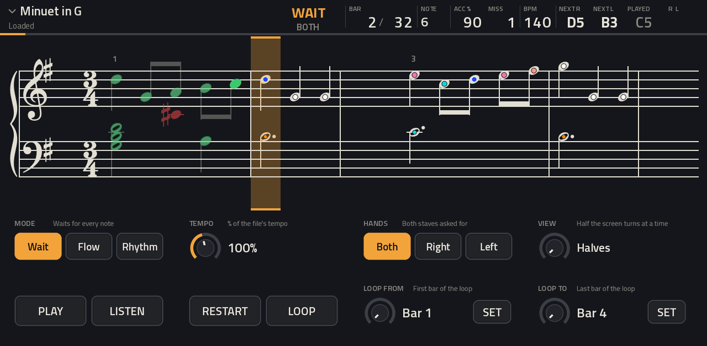
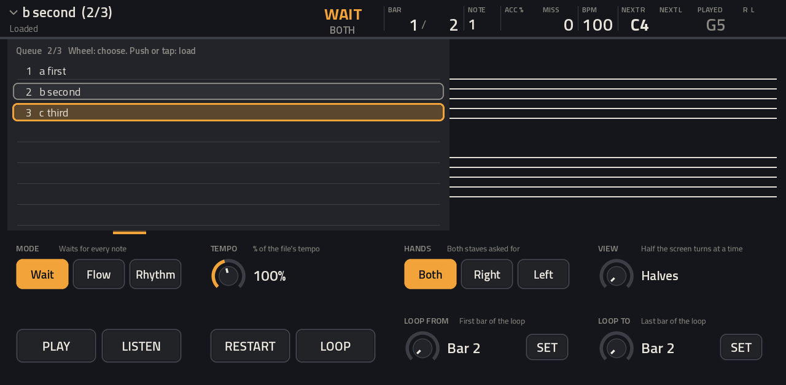

# Sight Reader for the MPC

A sight-reading trainer that runs entirely on an Akai MPC (MPC OS 3.10.1 or later), as a plugin
built with Akai's official [MPC plugin SDK](https://github.com/inmusic-software/mpc-plugin-builder-sdk).
It shows a grand staff in standard notation on the MPC's screen, listens to what you play on the
track's MIDI input (any keyboard or MIDI controller, the MPC's own keys or pads, a LinnStrument)
and checks it against a MIDI file or a freshly generated exercise: notes turn green when you play
them, a wrong note shows in red where you played it, and the music moves on as you read. It can
play the piece to you first (LISTEN), keeps your progress per piece, and with a LinnStrument it
can light the next notes, whole passages, suggested fingerings and the project's key on the
instrument itself.

*Dedicated to Roger Linn and Geert Bevin, creators of MPE and the LinnStrument, and to Wendy
Carlos, the pioneer without whom none of this would be possible.*



**[Download the latest release](https://github.com/uncertainblume/mpc-sightreading/releases/latest)**
(a zip to copy to the MPC; what changed in each version is in [CHANGELOG.md](CHANGELOG.md)).


If anyone finds any of this this super useful and can afford it, send me a tip on PayPal, I'm hilariously unemployed: 

**Status: version 0.5.5.** Sight Reader has been in use on an MPC Live III since 0.1: the pages,
the notation, the cursor, the practice modes, LISTEN, the piece list and the LinnStrument's lights
work on the device. 0.5.5 answers the notes from playing 0.5.1:

- **LISTEN transport**: pause and go on from the same place. The Bar field and the jog wheel move
  what you hear, and **SET** next to Loop From / Loop To marks the loop at the bar you hear.
- **Accompaniment**: with one hand practised, the other hand plays to MIDI Out in time. In Wait
  mode it waits for you whenever your note is due. It is on by default.
- **LinnStrument**:
  - **Fit Range** folds notes the surface cannot play into its range.
  - The guide always shows the next note to press, and has its own colour for the note after.
  - It follows the instrument's Octave and Transpose, read from the instrument.
- **The jog wheel steps evenly**: one step per click on every number (Tempo 100, 101, 102...).

0.5.5 passes the SDK's validator (0 errors, 0 warnings), its host simulator, and an end-to-end
test that plays pieces through the plugin's VST interface and checks the screen. Its new features
have not yet been tried on the MPC.

## What you can use it with

### Any MIDI keyboard or controller

Sight Reader needs nothing but notes on the track's MIDI input, on any channel:

- **Keyboards** of any size, by USB or DIN.
- **The MPC Key 61 / Key 37's own keys.**
- **The MPC's pads** in a chromatic or scale pad-perform mode.
- **MPE controllers** (Seaboard, Osmose, LinnStrument...): every channel is listened to.
- **Wind controllers and MIDI guitars.**

What helps with a small or unusual instrument:

| If your instrument... | Use |
|---|---|
| has fewer keys than the music needs | **Pitch Tol = Octave** (the right note in any octave counts), or **Range** (MORE) to ask only for notes you have, or **Transpose** |
| is set an octave off | the message line says so ("You play C5, the music says C4"); Octave tolerance or transpose the instrument |
| is played one hand at a time | **Hands = Right / Left**; the other staff is dimmed and not asked for |
| sends a whole piece on one channel | **Split** (MORE) divides a one-track file into hands at a note |

Sight Reader makes no sound of its own except a quiet error sound and an optional metronome: your
instrument stays on its own track listening to the same input, so you hear yourself. LISTEN and
Accomp send MIDI to an instrument track of your choice instead.

### A LinnStrument, in addition

Switch **Linn Mode** on (LINN page) and the instrument lights:

- the next notes to press (in its own Played colour or any colour), and the step after in a
  colour of its own; a note you press goes dark and the next one lights;
- a suggested cell and finger for each note (a hand-position planner for the fourths grid);
- every note of the loop or of the bars on screen (LIGHT BARS);
- the MPC project's key or pad scale (Key Lights);
- each note as it sounds while LISTEN plays.

Notes the surface cannot play are folded by octaves onto it (**Fit Range**), and the lights follow
the instrument's own Octave and Transpose (read from it over USB). Your note-light settings are
never changed: with a custom light pattern, **Restore = Pattern n** puts it back exactly after
any coloured lights. On the staff, every note can carry a dot of its LinnStrument colour (COLOR
page), so the screen speaks the instrument's colour language.

**If the lights do nothing:** unplug the
LinnStrument and plug it back in, then press TEST LIGHTS (LINN page). On the author's MPC Live III the LinnStrument once stopped taking anything the MPC
sent it over USB, and a replug brought it back. The MPC's MIDI Out jacks are a second route. See
[docs/linnstrument.md](docs/linnstrument.md).

## What it does

| | |
|---|---|
| **Notation** | Grand staff (treble and bass) with key and time signatures, ledger lines, accidentals spelled by key and by melodic direction, dotted notes, ties, flat beams, flags, rests, triplet marks, pickup bars detected automatically, 8va / 8vb lines for notes far off the staff. Engraved with the Bravura music font. |
| **Scrolling** | Four views: *Halves* (default: one half of the screen is rewritten with what comes next while you read the other), *Page* (turns when you reach the end), *Bars* (the current bar is always first), *Steps* (the music moves under a fixed cursor). |
| **Modes** | *Wait*: holds on every note until you play it. *Rhythm*: a clock runs at the tempo you set and grades timing. *Flow*: the clock runs but waits up to *Hold* beats for a missed note before moving on. |
| **Moving around** | Tap **Bar**, **Note** or **BPM** in the header and turn the data wheel (or Q-Links 5-7): jump bar by bar or note by note, set the tempo directly. With Start = MPC Play, the MPC's Play and Stop start and pause practice, and moving the MPC's playhead (locate, step and event buttons, Stop twice for the start) moves you to the same bar. |
| **Pieces in order** | Load one file and its folder becomes the piece list: tap the title on PLAY to pick another with the data wheel, see *(3/12)* after the title, and let **Auto Next** load the next piece when one ends. Build a **Playlist** of any files, in your order, on the LOAD page. |
| **Slack** | Timing window (40-400 ms), pitch tolerance (exact, any octave, a semitone either way), chord tolerance (all notes, all but one, any one), how long Flow waits, whether wrong notes are ignored, counted or stop the clock. |
| **Focus** | Right hand, left hand or both; a note range (outside it notes are not asked for, or removed from the score); loop any span of bars (Loop From, Loop To and Loop Bars follow each other), with an optional tempo ramp after each pass at or above your goal; masks that hide notes once played, or hide the bar you are in so you have to read ahead. |
| **Listen** | LISTEN (on PLAY) plays the piece, or the loop, in time as MIDI through the port "Sight Reader MIDI Out", so any instrument track (a plugin, a keygroup, a drum program) set to that input plays it as an example. Press it again to pause and once more to go on; while it is on, the Bar and Note fields (and the jog wheel) move what you hear, and **SET** next to Loop From / Loop To marks the loop at the bar you hear. Speed: the Tempo knob, or a fixed 25-150 %. The cursor follows the music, and in Linn Mode the LinnStrument lights the notes as they sound. Your practice position stays where it was. |
| **Accompaniment** | Practising one hand, the other hand plays to "Sight Reader MIDI Out" in time (Accomp, MORE, on by default); in Wait mode it waits for you whenever your next note is due. |
| **Feedback** | A band marks the current note; notes you play turn green, missed notes red, and a wrong note appears as a red note where you played it (with its accidental). A red flash can cover the staff on a mistake. The header shows the next note of each hand and the note you played, and says what is wrong when you seem stuck (the other hand's note still wanted, or an instrument an octave off). A quiet error sound (six timbres, volume, pitch and an ADSR envelope) sounds on a mistake and again softer on every Nth note afterwards, so you notice during a fast run. Accuracy, misses, bar and tempo are on screen. |
| **Note colours** | A dot of each note's colour in every notehead still to be played, set per note on the COLOR page. The default is a LinnStrument scheme: C cyan, D blue, E pink, F magenta, G white, A yellow, B orange, with in-between hues for the black keys (D# navy, F# a light salmon pink...). |
| **Readouts** | Under every setting, a line that says what its current choice does ("Count: a wrong note lowers accuracy; the music goes on"); values carry their units (160 ms, 30%, Ch 1). |
| **Material** | 224 built-in drills (scales and arpeggios for each hand, modes, intervals, rhythm levels 1-5, ledger lines, hands-together scales and coordination, LinnStrument shapes), an exercise generator (any key and mode, rhythm and leap difficulty 1-5, left-hand styles), and a library you fill from the [Mutopia Project](https://www.mutopiaproject.org) or with your own files over SSH. |
| **Progress** | Per piece: plays, best and last accuracy, minutes, best tempo reached at your goal, and accuracy for each sixteenth of the piece; a day streak. Stored in `SightReader/progress.tsv` on the MPC's drive. |
| **Themes** | PLAY comes in Night and Day: press its function key again for LIGHT, the same page on light paper. The settings pages use the MPC's own dark style. |



## Install

You need MPC OS 3.10.1 or later with **Preferences → Enhancements (Beta) → Enable Enhancements**
and **External Plugin Support** switched on.

1. Download `sight-reader-0.5.5-mpc.zip` from the
   [releases](https://github.com/uncertainblume/mpc-sightreading/releases) (the same file is in
   [dist/](dist/)) and unzip it, or build it yourself (below).
2. Copy the folder `Practice Tools - VST - Sight Reader` into `VST2 Plugins` at the top of the
   MPC's **internal** drive (`/nvme` on a Live III; removable drives are mounted `noexec`), or
   over the network with the SDK's tool (it asks before restarting the MPC app; save your project
   first):

   ```bash
   python3 third_party/mpc-plugin-builder-sdk/tools/mpc_remote.py <mpc-ip> --drive 1 update dist/sight-reader-0.5.5-mpc.zip
   ```
3. Restart the MPC app. Sight Reader is under **External Plugins**. Projects that already use it
   keep their settings.

### Set up a track

1. Make a plugin track with **Sight Reader**. MIDI input: your keyboard, controller or
   LinnStrument, all channels; monitor **Merge** (always listening).
2. Your instrument sound stays on its own track, also listening to the controller with monitor
   Merge, so you hear yourself while Sight Reader listens.
3. On **LOAD**, turn the data wheel to a piece and push it (or tap it and press LOAD); or **GEN**
   → **GENERATE**. *Drills: Scales* is right hand only; *Scales LH* the left; *Two Hands* both at
   once.
4. **PLAY**: in Wait mode just start playing. In Rhythm or Flow press PLAY (or tap the staff) for
   a count-in. With **Hands = Both**, a piece written for two hands waits for both: set Hands to
   Right or Left to practise one.

To hear the piece with **LISTEN**: give an instrument track (any plugin or program) the MIDI
input **Sight Reader MIDI Out**, channel All (or Out Ch, MORE page), monitor **In**; then press
LISTEN on PLAY. To hear it on the instrument you play, give that instrument a second track with
this input (or set its input to *All Ports*). If the port is not in the list: Preferences → MIDI /
Sync → Input Ports, turn **Track** on for it. Do not set Sight Reader's own track input to *All
Ports* (its LISTEN and Accomp notes would come back to it).

## Fill the library over SSH

```bash
python3 tools/library.py sync 192.168.1.20
```

That downloads the 70 curated pieces in [library/catalog.tsv](library/catalog.tsv) (Bach's
Anna Magdalena notebook, Czerny, Burgmüller, Tchaikovsky, Schumann, Satie, Chopin, Mozart,
Clementi, Joplin...) into `library/cache/` and copies them to `/nvme/SightReader/Library` on the
MPC in one SSH command. Then press **RESCAN** on the LOAD page. More:

```bash
python3 tools/library.py mutopia "Clementi" --max 20
```

```bash
python3 tools/library.py add ~/Music/*.mid --collection "My Songs"
```

```bash
python3 tools/library.py device-script > get.sh && ssh root@192.168.1.20 sh -s < get.sh
```

The last one downloads straight onto the MPC, if its firmware has `curl` or `wget`. Popular songs
under copyright are not included: add your own files with `add`.

## Build

Needs Python 3.9+, git and a C++ compiler; Pillow (`pip install pillow`) only to regenerate the
skins.

```bash
tools/build.sh
```

```bash
tools/run_tests.sh
```

The first build fetches Akai's SDK (pinned commit) and, through it, the Zig cross compiler. The
output folder is `plugin/build/Practice Tools - VST - Sight Reader/`. Releases are built by the
[release workflow](.github/workflows/release.yml) from tags like `v0.5.5`.

## Read more

- [docs/user-guide.md](docs/user-guide.md): every page and setting.
- [docs/linnstrument.md](docs/linnstrument.md): the LinnStrument features, the routes, the MIDI
  they use, and the USB problem.
- [docs/design.md](docs/design.md): how a plugin with no drawing API shows scrolling notation,
  the evidence behind each choice, and the limits.
- [docs/handoff.md](docs/handoff.md): what is tested, what to check first on the MPC, open
  questions, ideas.
- [CHANGELOG.md](CHANGELOG.md): what changed in each version.

## Layout

```
plugin/                the SDK project: plugin.json, src/, skins/ (generated), Content/Drills/
plugin/src/SightReader.cpp   the plugin: parameters, audio thread, worker thread
plugin/src/sr/         MIDI files, notation layout, practice engine, generator, LinnStrument,
                       ALSA ports, library and progress files (header-only, no SDK needed)
plugin/src/sr/gen/     tables generated by tools/gen_skin.py (must match the skins)
tools/gen_skin.py      writes plugin/skins and the generated headers
tools/skin/            screen geometry, the frame catalogue, glyph rendering, page previews
tools/make_drills.py   the built-in drills
tools/library.py       library download and SSH push
library/catalog.tsv    the curated list of pieces
tests/                 unit tests, the end-to-end plugin test
dist/                  the ready-to-install zip of the current version
```

## Credits and licences

MIT licensed (see LICENSE). Music glyphs are rendered from **Bravura** (Steinberg, SIL Open Font
License 1.1) and text from **Titillium Web** (SIL OFL 1.1); only the rendered images ship in the
plugin. MIDI files from the **Mutopia Project** are public domain or Creative Commons as listed on
each piece's page; they are downloaded by you, not bundled. The ALSA port code is adapted from
the author's [mpc-mpe](https://github.com/uncertainblume/mpc-mpe). The LinnStrument note layout
and lighting messages follow Roger Linn Design's open-source firmware (Apache 2.0).

Not affiliated with Akai Professional, inMusic, Roger Linn Design or the Mutopia Project.
