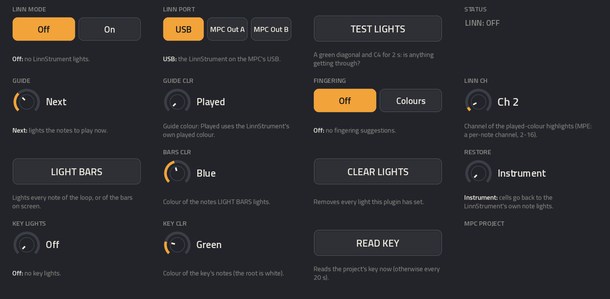
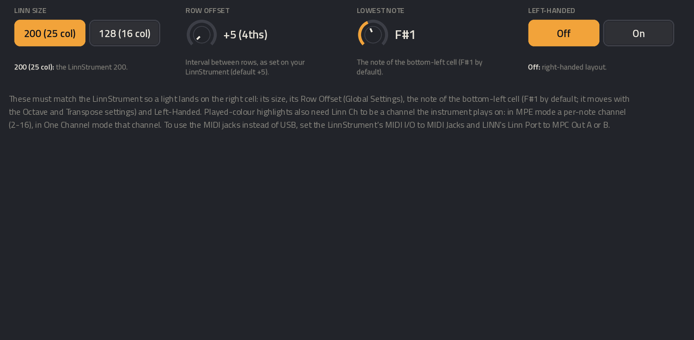

# LinnStrument features

Everything in Sight Reader works with any MIDI keyboard or controller. With a LinnStrument it
can also light the instrument: the next notes to play, a whole passage, suggested fingerings, the
project's key. Switch **Linn Mode** on (LINN page). Nothing here changes your LinnStrument's own
settings, and **CLEAR LIGHTS** takes away everything the plugin lit.

> **Status (0.5.0): work in progress.** The light messages reach the LinnStrument (TEST LIGHTS
> works; if it stops, see below), but the guide lights are not worked out: with Guide = Next and
> Next+1 the lights change, with several odd behaviours still to debug. The rest of this page
> describes how the features are meant to work.



## Connecting

**Linn Port** says which way the light messages go:

- **USB**: to the LinnStrument plugged into the MPC's USB. The plugin finds it by name (it looks
  every three seconds while Linn Mode is on).
- **MPC Out A / MPC Out B**: out of the MPC's MIDI Out A or B into the LinnStrument's MIDI In
  jack. The LinnStrument sends and receives MIDI either over USB or over its MIDI jacks, not
  both (Global Settings, *MIDI I/O*), so this route needs the jacks both ways: a cable from the
  LinnStrument's MIDI Out to the MPC's MIDI In (what you play), and one from the MPC's MIDI Out A
  (or B) to the LinnStrument's MIDI In (the lights). USB then only powers it.

**STATUS** (top right) says what is connected. **TEST LIGHTS** paints a green diagonal across the
surface and lights middle C with a Note On on Linn Ch, for about two seconds, whether or not Linn
Mode is on. If nothing lights, the messages are not getting through, and no other setting will
help until they do.

### If nothing lights: unplug it and plug it back in

With 0.4.0 nothing the MPC sent over USB lit the author's LinnStrument 200 (firmware 2.3.x, MIDI
I/O = USB). That included the plugin's paints and Note Ons, single messages sent by hand, and a
plain MPC MIDI track. The bytes did leave the MPC: the kernel's byte counter for the port went up.

After installing 0.5.0, unplugging the LinnStrument from the MPC and plugging it back in was
enough: TEST LIGHTS lit it. The same messages sent from a Mac (with
[SendMIDI](https://github.com/gbevin/SendMIDI)) lit it too. The cause of the stuck state is not
known yet, so if the lights stop, try these in order:

1. Unplug the LinnStrument and plug it back in, then press TEST LIGHTS.
2. Check Linn Ch. The Played-colour highlight only answers on a channel the instrument plays
   on: 2 for an MPE LinnStrument.
3. Test from a computer. SendMIDI's releases page has a ready Mac build
   (`sendmidi-macOS-<version>.zip`; its Homebrew formula builds from source and needs the full
   Xcode). macOS may quarantine the downloaded binary, which
   `xattr -d com.apple.quarantine sendmidi` lifts. Then run:

   ```bash
   ./sendmidi dev "LinnStrument MIDI" cc 20 5 cc 21 3 cc 22 3 ch 2 on 60 100; sleep 3; ./sendmidi dev "LinnStrument MIDI" ch 2 off 60 0 cc 22 7
   ```

   The cell in column 5, row 3 should turn green, and every middle C should light in your Played
   colour, for three seconds. `./sendmidi list` shows the device's exact name.
   (`tools/linn_test_mac.py` does the same without downloading anything, but is not proven yet.)
4. As a last resort, use the MIDI jacks (Linn Port = MPC Out A/B, above).

## Guide lights

**Guide**: Off, Next (the notes to play now), Next+1 (now, plus the step after in white),
Fingered (only the suggested cell, in the finger's colour). **Guide Clr**:

- **Played** uses the LinnStrument's own highlight: a Note On sent to the instrument lights every
  cell of that note in the *Played* colour, and the Note Off clears it (`ls_midi.ino`,
  `highlightPossibleNoteCells`). It needs no layout settings, and the cell under your finger
  clears when you play it. It only works on a channel the instrument plays on: **Linn Ch**.
- Any other colour paints the cells with CC 20 (column), CC 21 (row), CC 22 (colour). This needs
  the layout settings (LAYOUT, below).

**Linn Ch** (default 2): in MPE mode, a per-note channel of the split you play (2 to 16 with the
factory settings; channel 1 is the MPE main channel, which the highlight ignores). In One Channel
mode, that channel. 0.4.0 defaulted to 1, which an MPE LinnStrument ignores.

While **LISTEN** plays (PLAY page), the guide lights each note as it sounds instead of the next
one to play: watch the shape of a passage on the surface while you hear it.

## What happens to your own lights

Cell paints (CC 20/21/22) go into the firmware's custom layer, the same layer as the
LinnStrument's own custom light patterns. So the plugin paints only the cells it needs, and a
cell it has finished with goes back to:

- **Restore = Note Colors** (default): your note colours from the COLOR page, in the
  LinnStrument's nearest colour (C cyan, D blue, E pink, F magenta, G white, A yellow, B orange;
  C# cyan, D# blue, F# pink, G# white, A# yellow).
- **Restore = Off**: colour 7, which turns the painted cell off and lets your normal note lights
  show through again.

Cells the plugin never painted are never written. Messages are paced to the route: up to about
3,000 a second over USB (the instrument's USB side reaches its processor through a 115,200-baud
serial link) and 900 a second through a DIN port (31,250 baud).

## Fingering

**Fingering = Colours** picks a cell and a finger for every note, per hand, and colours the next
notes' cells: yellow thumb, green index, cyan middle, blue ring, magenta little. The header on
PLAY shows the finger numbers.

How it chooses: a hand position is the column of your index finger; one finger per column (like
a fretting hand), thumb one column back; reaching another row is cheap, moving the hand along
the rows is not, and the same finger on two different cells in a row costs extra. A Viterbi pass
over every candidate cell and hand position finds the cheapest path through the piece. A C major
scale comes out as the familiar box: C D on one row, E F G on the next, A B C on the next, all in
one hand position. Chord notes go where the hand already is.

It is a suggestion from geometry alone: it knows nothing of your hands or of phrasing. It is
planned when a piece loads, and again when you change the layout settings.

## LIGHT BARS

Lights every note of the loop (if Loop is on) or of the bars on screen, in **Bars Clr**, so you
can see the shape of a passage on the surface before playing it. Press again to clear. It
re-lights itself when you move the loop.

## Key Lights

Paints every cell of a key's scale in **Key Clr** (the root in white):

- **MPC Key**: the project key (the *key* the MPC shows in its Sounds browser and uses for key
  matching, saved as `"key": "C Major"` in the project file).
- **Pad Scale**: the pad-perform scale (`padPerformSettings`, root and scale type).
- **Piece Key**: the key signature of the piece loaded.

The MPC does not tell plugins about its key, so the plugin reads the project file the MPC saves:
`/data/Settings/MPC/CurrentProject` names it, and the newer of the project and its autosave is
read (gzip JSON). It re-reads every 20 seconds while Key Lights is on, and when you press
**READ KEY**. A change of key on the MPC shows up after the MPC saves (autosave is every
5 minutes by default; saving the project shows it at once). "No project key yet" means the
project has not been saved since it was created.

## Note colours on the staff

The COLOR page puts a dot of each note's colour in the noteheads on the MPC screen, so the staff
speaks the same colour language as your instrument. Its palette is the LinnStrument's own colours
(the firmware's Red, Yellow, Green, Cyan, Blue, Magenta, White, Orange, Lime, Pink) plus
in-between hues for the black keys, which exist on the screen only. The default scheme is
C cyan, D blue, E pink, F magenta, G white, A yellow, B orange; C# azure, D# navy (a deeper blue
than D), F# a light salmon pink, G# cream, A# amber.

## LAYOUT (press LINN again)



The plugin needs your layout to know which cell plays which note (everything except the Played
guide uses it):

| Setting | Default | Meaning |
|---|---|---|
| Linn Size | 200 (25 columns) | or 128 (16 columns) |
| Row Offset | +5 (fourths) | +4, +3, +6, +7 or Octave |
| Lowest Note | F#1 (30) | the note of the bottom-left playing cell. Fourths: 30; octave offset: 18; add 12 for each octave you transposed up |
| Left-Handed | Off | mirrors the columns |

These follow the firmware's mapping (`determineRowOffsetNote`, `getNoteNumber`):
`note = lowest + row × offset + column - 1`. Splits and guitar tuning are not modelled; with a
split active, set Lowest Note for the split you play in.

## How the messages travel

The plugin opens its own ALSA sequencer client, "Sight Reader", with two ports:

- **Linn Out** cannot be subscribed to by anyone else (read-only, not exported), so light
  messages reach only the LinnStrument, never an MPC track listening to "All Ports" (where a
  guide Note On would play a sound). The plugin subscribes it itself to the LinnStrument's USB
  port, or to the MPC's own DIN port ("DIN-A" / "DIN-B" of the MPC's kernel MIDI client) for
  Linn Port = MPC Out A / B. Changing Linn Port moves the subscription at once and repaints.
- **MIDI Out** is listed by the MPC as a track input ("Sight Reader MIDI Out") and carries
  LISTEN and Accomp.

## For a version without LinnStrument features

Everything LinnStrument-specific is behind Linn Mode, in `plugin/src/sr/linn.h`, `alsa_out.h`
and the `lightsBlock()` part of `SightReader.cpp`, plus the LINN and LAYOUT pages. A general
version can drop those pages from `tools/gen_skin.py` (PAGES) and leave Linn Mode off; nothing
else depends on it.
