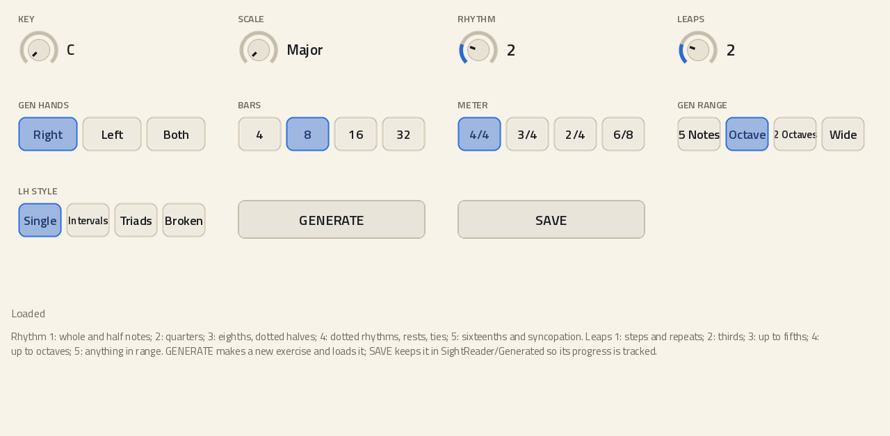
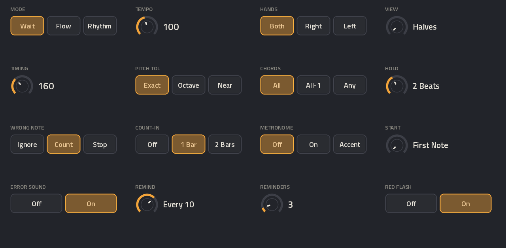
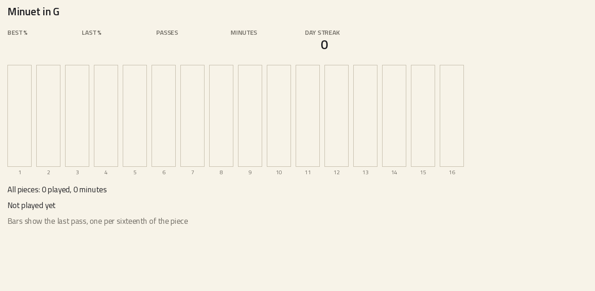

# Sight Reader: user guide

Pages are the function keys under the screen. **Press a page's key a second time to switch
between Night and Day**; both versions control the same settings. The 16 Q-Links follow the
on-screen controls row by row (top row = Q-Links 13-16); on PLAY the lower two knob rows have no
on-screen controls: Q-Links 5-8 are Loop Bars, Timing, Pitch Tol, Chords; 1-4 are Blip Vol,
Metronome, Count-in, Mask. Double-tap a control (or press the data wheel) for the MPC's large
editor or list. The MPC's preset menu offers five practice presets (Wait exact, Wait relaxed,
Flow medium, Rhythm strict, Rhythm slow); they change only practice settings.

## PLAY

- **Header:** title and last message; status (WAIT / FLOW / RHYTHM / LOOP / COUNT-IN / PAUSED /
  DONE / LOADING / NO FILE) and which hands; current bar / bars; accuracy (correct notes divided
  by correct + missed + wrong); misses and wrong notes; tempo in BPM after your Tempo %; the next
  note to play; the last note you played; with LinnStrument fingering on, the suggested finger
  for each hand. A thin bar under the header shows how far through the piece you are.
- **Staff:** the current note has a coloured band; notes you have played fade; missed notes
  are tinted red; the whole staff flashes red on a wrong note (Red Flash) and green when a loop
  pass meets your goal. Small numbers above the staff are bar numbers. **Tap the staff** to start
  or pause.
- **Controls:** Mode, Tempo (20-200 % of the file's tempo), Hands, View; Play, Restart, Loop and
  Loop From.

### Modes

| Mode | The music moves | A note counts when | Unplayed notes |
|---|---|---|---|
| Wait | when you play the right notes | it is in the current step | wait for you; there is no clock |
| Flow | with a clock, at Tempo | it lands in the timing window | the clock holds up to **Hold** beats, then marks them missed and goes on |
| Rhythm | with a clock, at Tempo | it lands in the timing window | are marked missed when the window closes |

In Rhythm and Flow, **Start** decides how the clock starts: on your first correct note (no
count-in needed), on the Play button (with the Count-in you chose), or with the MPC's own
transport (press PLAY on the MPC). With **Wrong Note = Stop**, a wrong note holds the clock until
you play the right one.

### Slack

- **Timing ±** (40-400 ms): how early or late a note may be.
- **Pitch Tol:** Exact; Octave (right note name, any octave: useful when a passage sits out of
  your instrument's range); Near (a semitone either way).
- **Chords:** All notes; All-1 (one may be missing); Any (one note of the chord is enough).
- **Hold** (Flow): ½, 1, 2, 4, 8 beats or Forever.
- **Wrong Note:** Ignore, Count (accuracy goes down), Stop (Rhythm/Flow wait for the right note).

### Views

- **Halves** (default): the screen is two halves. While you play in one, the other is rewritten
  with the music that follows, so there is always at least half a screen ahead of you.
- **Page:** the whole screen turns when you reach its end.
- **Bars:** the bar you are in is always the first on screen.
- **Steps:** the music moves under the cursor on every note. Smoothest to read, but it redraws
  the whole staff on every step: try it on a Live III, avoid it on older MPCs.

## LOAD

Folder (knob), Scroll (knob), Sort (Name, Best %, Recent, Level). Tap a row to select it, then
**LOAD**. Each row shows your best accuracy for that piece. The details panel shows the composer,
level, your record and where the file came from. **RESCAN** after copying new files.

Folders: `Drills: ...` are built in. Your library is `SightReader/Library/<folder>/` on the drive
the plugin is installed on (`/nvme/SightReader/Library` on a Live III's internal drive); each
sub-folder is a folder here. Exercises you save from GEN are in `Generated`.

Files: standard MIDI files (format 0 or 1). Two or more tracks are split into hands by track name
(right/left/treble/bass/upper/lower) or by average pitch; a single track is split at **Split**
(MORE page). Files from notation programs read best; recordings of real playing are quantised
to the nearest sixteenth or triplet and may look busy.

## GEN

Makes a new exercise on demand: **Key** (or Random), **Scale** (major, minor, the modes, harmonic
minor, pentatonics, blues, chromatic), **Rhythm** 1-5, **Leaps** 1-5, **Gen Hands** (right, left,
both: the left hand then plays an accompaniment), **Bars**, **Meter**, **Gen Range** (5 notes,
octave, two octaves, wide), **LH Style** (single notes, intervals, triads, broken chords).
**GENERATE** loads a fresh one every time; **SAVE** keeps the current one in `Generated/` (only
saved files keep progress records).

## SETUP and MORE

SETUP has the practice settings above plus: **Count-in** (off, 1 or 2 bars), **Metronome** (off,
on, accented downbeat), **Start**, **Error Blip** (a short square-wave tone on every wrong or
missed note), **Remind** and **Reminders** (after a mistake, the blip sounds again softer on every
5th, 10th or 20th note you play, up to N times, so you notice a slip during a fast run), and
**Red Flash**.

MORE: **Range Lo / Hi** and **Out Range** (Play everything; Skip: notes outside are shown but not
asked for; Hide: they are taken out of the score), **Mask** (hide notes once played, or hide the
bar you are in so you must read ahead), **Note Names** (header shows the next note, or next and
played), **Accomp** (sends the other hand's notes, or all notes not required, to the port
"Sight Reader MIDI Out" so an instrument track can play them; route a track's input to that
port), **Split**, **Transpose** (reloads the piece), **Tempo Ramp** (+2/5/10 % after each loop
pass at or above **Goal**), **Blip Vol**, **Loop Bars**.

## LINN

See [linnstrument.md](linnstrument.md).

## STATS

For the piece loaded: best and last accuracy, passes, minutes practised, and your day streak
(days in a row with at least one pass). The bars show the last pass's accuracy for each sixteenth
of the piece, so weak passages stand out. A pass is recorded at the end of the piece or of each
loop. Records are in `SightReader/progress.tsv` (one line per piece; safe to back up or edit).

## Practising: a suggested routine

1. A drill or a generated exercise you have never seen, Wait mode, both hands, at a modest
   level. Don't stop when you miss a note: let the red flash tell you and keep going.
2. The same kind of material in Flow at 70-80 % tempo, Hold 1 beat.
3. A piece from the library, loop four bars with Tempo Ramp +5 % and Goal 90 %, Rhythm mode.
4. Mask = Bar for a few passes to force reading ahead.
