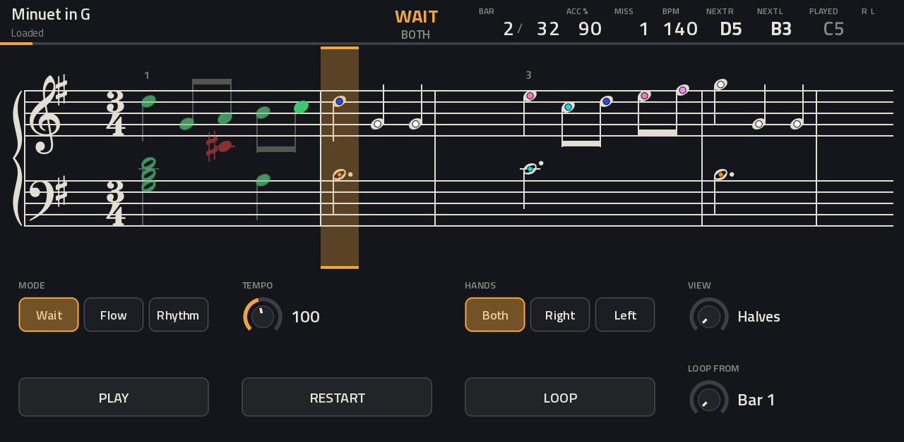
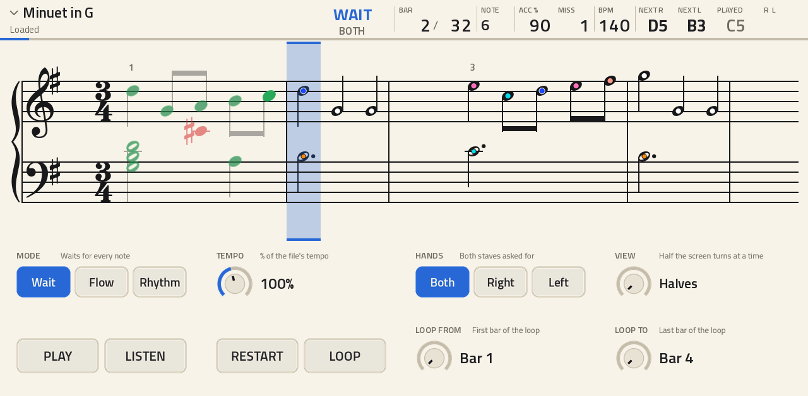
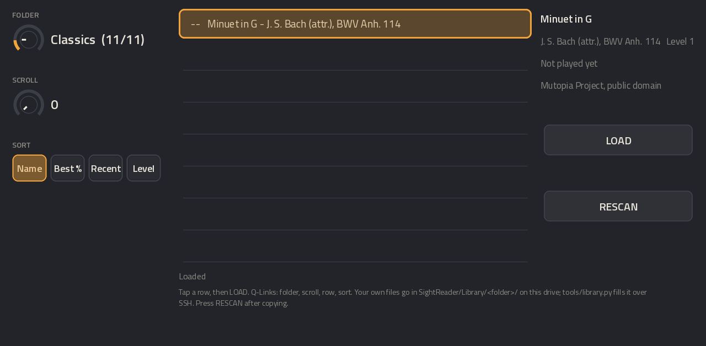
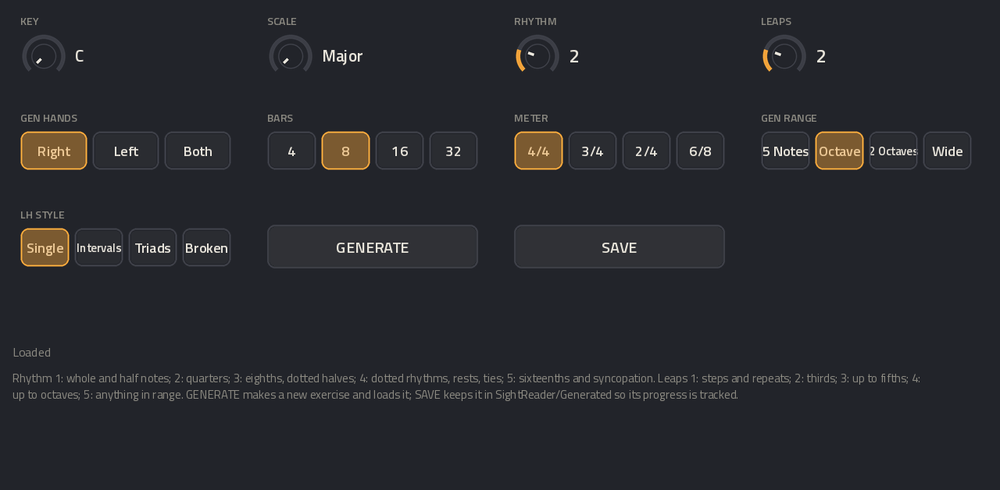
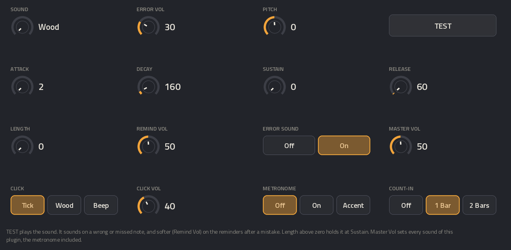
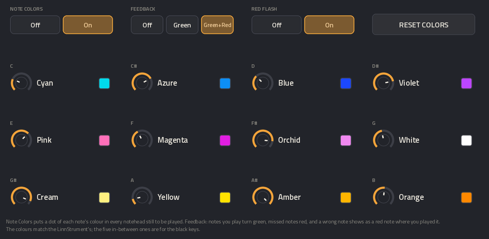
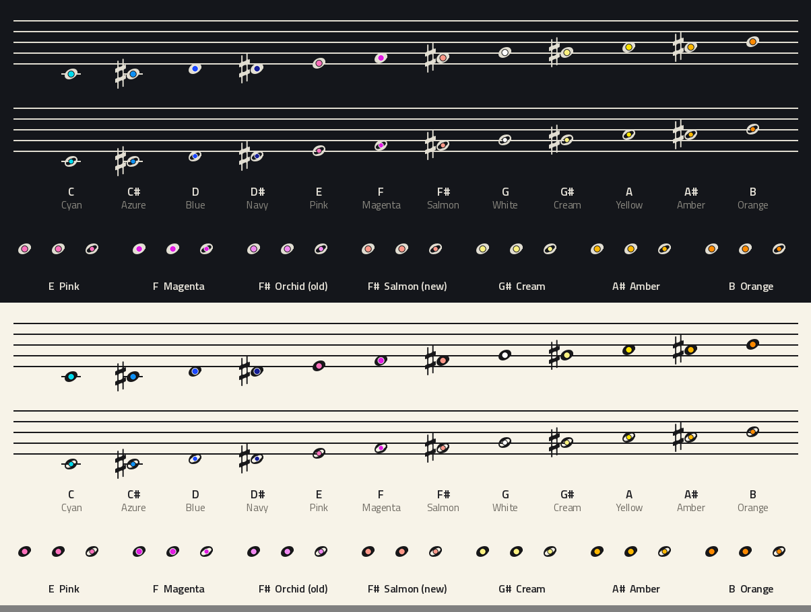
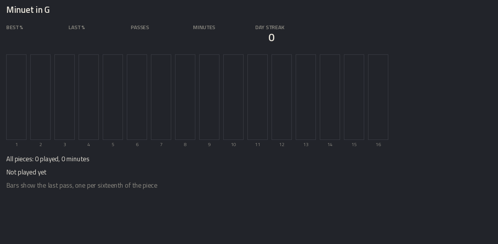

# Sight Reader: user guide

Pages are the function keys under the screen: PLAY, LOAD, GEN, SETUP, MORE, SOUND, COLOR, LINN,
STATS. **Press PLAY's key a second time for LIGHT**, the same page on light paper; both versions
control the same settings. The 16 Q-Links follow the on-screen controls row by row (top row =
Q-Links 13-16); on PLAY the lower two knob rows have no on-screen controls: Q-Links 5-8 are Loop
Bars, Timing, Pitch Tol, Chords; 1-4 are Error Vol, Metronome, Count-in, Mask. Double-tap a
control (or press the data wheel) for the MPC's large editor or list. The MPC's preset menu offers
five practice presets (Wait exact, Wait relaxed, Flow medium, Rhythm strict, Rhythm slow); they
change only practice settings.

Every switch has its options written on its buttons, the chosen one filled in. Under each control
a readout says what the current choice does, and changes as you change it; values show their
units (160 ms, 30%, +2 st, Ch 1).

## PLAY

- **Header:** title and last message; status (WAIT / FLOW / RHYTHM / LOOP / COUNT-IN / PAUSED /
  DONE / LOADING / NO FILE) and which hands; current bar / bars; accuracy (correct notes divided
  by correct + missed + wrong); misses and wrong notes; tempo in BPM after your Tempo %; the next
  note for each hand (**Next R**: the top of the right hand's chord, **Next L**: the bottom of the
  left hand's); the last note you played; with LinnStrument fingering on, the suggested finger
  for each hand. A thin bar under the header shows how far through the piece you are.
- **Staff:** the current note has a coloured band. Notes you play turn green (they stay bright
  for a moment, then fade with the rest of what you have played); notes you miss in Rhythm or
  Flow turn red; a wrong note appears as a red note where you played it, with its accidental and
  ledger lines, and stays (lighter) in that column so you can see afterwards what you played.
  With Note Colors on, every note still to be played has a dot of its colour (COLOR page). The
  whole staff can flash red on a mistake (Red Flash) and flashes green when a loop pass meets your
  goal. Small numbers above the staff are bar numbers. **Tap the staff** to start or pause.
- **Messages:** when two wrong notes in a row look like the same slip, the message line says so:
  "Waiting for the left hand (G3)" when a piece for both hands still wants a left-hand note (set
  Hands to Right to practise the right hand alone), or "You play C5, the music says C4" when your
  instrument sounds an octave away from the music (Pitch Tol = Octave accepts any octave, or
  transpose the instrument).
- **Controls:** Mode, Tempo (20-200 % of the file's tempo), Hands, View; Play, Listen, Restart,
  Loop and Loop From.

### Listen

**LISTEN** plays the piece in time, as an example of how it goes: from the start of the bar you
are in (from the beginning once the piece is done), or the loop round and round while Loop is on.
The notes go out as MIDI through the port **Sight Reader MIDI Out**, so whichever instrument track
listens to that port plays them: a plugin, a keygroup program, anything. While it plays, the
cursor follows the music (status LISTEN), the header shows the notes sounding, colour dots stay
on, and in Linn Mode the LinnStrument lights each note as it sounds (with Guide on). Nothing you
play is graded meanwhile and your practice position stays where it was. It stops at the end, or
when you press LISTEN again, PLAY or RESTART.

Setting it up once: on the instrument track you want to hear it on, MIDI input **Sight Reader
MIDI Out**, channel All (or the channel set in Out Ch), monitor **In**. To hear it on the same
sound you play with, either duplicate your instrument's track and give the copy this input, or set
your instrument track's input to *All Ports*. If the port is missing from the list: Preferences →
MIDI / Sync → Input Ports, turn **Track** on for "Sight Reader MIDI Out". Keep Sight Reader's own
track on your controller, never *All Ports*.

Speed (MORE page, **Listen At**): *Tempo* follows the Tempo knob (turn it while it plays), or a
fixed 25, 50, 75, 100, 125 or 150 % of the file's tempo. **Listen Hands**: Both, or only the
hands you practise (the Hands setting).

### Modes

| Mode | The music moves | A note counts when | Unplayed notes |
|---|---|---|---|
| Wait | when you play all the notes of the current step (both hands, with Hands = Both) | it is in the current step | wait for you; there is no clock |
| Flow | with a clock, at Tempo | it lands in the timing window | the clock holds up to **Hold** beats, then marks them missed and goes on |
| Rhythm | with a clock, at Tempo | it lands in the timing window | are marked missed when the window closes |

In Rhythm and Flow, **Start** decides how the clock starts: on your first correct note (no
count-in needed), on the Play button (with the Count-in you chose), or with the MPC's own
transport (press PLAY on the MPC). With **Wrong Note = Stop**, a wrong note holds the clock until
you play the right one.

### Slack

- **Timing ±** (40-400 ms): how early or late a note may be.
- **Pitch Tol:** Exact; Octave (right note name, any octave: useful when a passage sits out of
  your instrument's range); Near (a semitone either way).
- **Chords:** All notes; All-1 (one may be missing); Any (one note of the chord is enough).
- **Hold** (Flow): ½, 1, 2, 4, 8 beats or Forever.
- **Wrong Note:** Ignore, Count (accuracy goes down), Stop (Rhythm/Flow wait for the right note).
- Playing a note of the current step again, or of the step you just finished within about half a
  second (a repeated chord, a bounce), is not counted as a mistake.

### Views

- **Halves** (default): the screen is two halves. While you play in one, the other is rewritten
  with the music that follows, so there is always at least half a screen ahead of you.
- **Page:** the whole screen turns when you reach its end.
- **Bars:** the bar you are in is always the first on screen.
- **Steps:** the music moves under the cursor on every note. Smoothest to read, but it redraws
  the whole staff on every step: try it on a Live III, avoid it on older MPCs.

## LOAD

Folder (knob), Scroll (knob), Sort (Name, Best %, Recent, Level). Tap a row to select it, then
**LOAD**. Each row shows your best accuracy for that piece. The details panel shows the composer,
level, your record and where the file came from. **RESCAN** after copying new files.

Folders: `Drills: ...` are built in: *Scales* and *Arpeggios* are for the right hand, *Scales LH*
and *Arpeggios LH* for the left, *Two Hands* has scales, arpeggios and pieces for both hands at
once; the others are one hand unless their title says otherwise. Your library is
`SightReader/Library/<folder>/` on the drive
the plugin is installed on (`/nvme/SightReader/Library` on a Live III's internal drive); each
sub-folder is a folder here. Exercises you save from GEN are in `Generated`.

Files: standard MIDI files (format 0 or 1). Two or more tracks are split into hands by track name
(right/left/treble/bass/upper/lower) or by average pitch; a single track is split at **Split**
(MORE page). Files from notation programs read best; recordings of real playing are quantised
to the nearest sixteenth or triplet and may look busy.

## GEN

Makes a new exercise on demand: **Key** (or Random), **Scale** (major, minor, the modes, harmonic
minor, pentatonics, blues, chromatic), **Rhythm** 1-5, **Leaps** 1-5, **Gen Hands** (right, left,
both: the left hand then plays an accompaniment), **Bars**, **Meter**, **Gen Range** (5 notes,
octave, two octaves, wide), **LH Style** (single notes, intervals, triads, broken chords).
**GENERATE** loads a fresh one every time; **SAVE** keeps the current one in `Generated/` (only
saved files keep progress records).

## SETUP and MORE

SETUP has the practice settings above plus: **Count-in** (off, 1 or 2 bars), **Metronome** (off,
on, accented downbeat), **Start**, **Error Sound** (on every wrong or missed note; the SOUND page
shapes it), **Remind** and **Reminders** (after a mistake, the sound comes again softer on every
5th, 10th or 20th note you play, up to N times, so you notice a slip during a fast run), and
**Red Flash**.

MORE: **Range Lo / Hi** and **Out Range** (Play everything; Skip: notes outside are shown but not
asked for; Hide: they are taken out of the score), **Mask** (hide notes once played, or hide the
bar you are in so you must read ahead), **Note Names** (header shows the next notes, or next and
played), **Accomp** (sends the other hand's notes, or all notes not required, to the port
"Sight Reader MIDI Out" so an instrument track can play them; route a track's input to that
port), **Split**, **Transpose** (reloads the piece), **Tempo Ramp** (+2/5/10 % after each loop
pass at or above **Goal**), **Loop Bars**. The bottom row is everything that goes out of "Sight
Reader MIDI Out": **Listen At**, **Listen Hands**, **Accomp**, and **Out Ch**, the MIDI channel
they use (1 by default; for an MPE synth pick a channel it plays notes on, such as 2).

## SOUND

The plugin's own sounds, all quiet by default:

- **Sound:** Wood (a soft knock, the default), Soft Tick (filtered noise), Low Thud, Bell, Sine,
  Square (0.1's blip, rounded off). **Error Vol**, **Pitch** (semitones), **TEST** plays it.
- **Attack, Decay, Sustain, Release, Length:** the envelope. With Length 0 the sound is a short
  hit (attack, then decay to nothing); with Length above zero it holds at Sustain until Length,
  then releases.
- **Remind Vol:** the reminders' level, relative to Error Vol. A missed note sounds a minor third
  lower than a wrong one.
- **Error Sound** switches it off altogether (the end-of-piece chime too). **Master Vol** scales
  every sound of the plugin, metronome included.
- **Click** (Tick, Wood, Beep) and **Click Vol** for the metronome and count-in; **Metronome**
  and **Count-in** as on SETUP.

## COLOR

- **Note Colors:** On puts a dot of each note's colour in every notehead not yet played (the dot
  goes when the note is played, so the colours lead your eye to what comes next).
- **Feedback:** Off; Green (played notes turn green); Green+Red (also missed notes red, and wrong
  notes shown as red notes where you played them).
- **Red Flash** as on SETUP. **RESET COLORS** brings back the default scheme.
- **C ... B:** a colour for each note (sharps and flats share their key). The choices are the
  LinnStrument's colours (Red, Yellow, Green, Cyan, Blue, Magenta, White, Orange, Lime, Pink) and
  in-between ones: Azure (cyan-blue), Violet (blue-pink), Orchid (magenta-white), Cream
  (white-yellow), Amber (yellow-orange), Navy (a deeper blue), Salmon (a light warm pink); or Off
  for no dot. The default: C Cyan, C# Azure, D Blue, D# Navy, E Pink, F Magenta, F# Salmon,
  G White, G# Cream, A Yellow, A# Amber, B Orange. Dark colours (Blue, Navy) get a light edge so they show on black noteheads.

The dot is sized so a half or whole note still looks hollow; on the hand you are not practising
(Hands = Right or Left) there are no dots or marks.

## LINN

See [linnstrument.md](linnstrument.md).

## STATS

For the piece loaded: best and last accuracy, passes, minutes practised, and your day streak
(days in a row with at least one pass). The bars show the last pass's accuracy for each sixteenth
of the piece, so weak passages stand out. A pass is recorded at the end of the piece or of each
loop. Records are in `SightReader/progress.tsv` (one line per piece; safe to back up or edit).

## Practising: a suggested routine

1. A drill or a generated exercise you have never seen, Wait mode, at a modest level, one hand
   and then both. Don't stop when you miss a note: let the red note tell you and keep going.
2. The same kind of material in Flow at 70-80 % tempo, Hold 1 beat.
3. A piece from the library, loop four bars with Tempo Ramp +5 % and Goal 90 %, Rhythm mode.
4. Mask = Bar for a few passes to force reading ahead.
